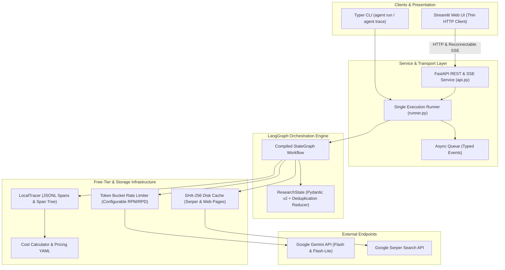

# Autonomous Deep Research Agent

[](https://github.com/r3kt003-web/rabbit-hole/actions/workflows/ci.yml)
[](https://www.python.org/)

A portfolio-grade **Autonomous Deep Research Agent** built with **LangGraph**, **Google Gemini**, **Serper**, **trafilatura**, **FastAPI**, and **Streamlit**.

Given a research prompt, the agent autonomously plans sub-questions, executes parallel web researchers, extracts grounded findings, synthesizes a structured report with inline citations (`[1]`, `[2]`), runs a **deterministic citation verifier** against cached source text, and evaluates the draft with an LLM evaluator—triggering conditional revision loops if quality criteria are not satisfied.

---

## Key Features

- **LangGraph State Machine Orchestration**: Fan-out execution using LangGraph's dynamic `Send` API with state deduplication reducers.
- **Deterministic Citation Verification**: Verifies source resolution, checks quotes using normalized windowed fuzzy matching (`rapidfuzz`, configurable `VERIFY_QUOTE_THRESHOLD=0.85`), and enforces a deterministic entailment guard for all figures/numbers *before* LLM evaluation.
- **Evaluator & Conditional Revision Loop**: Multi-dimensional grading across *Groundedness*, *Coverage*, *Citation Accuracy*, and *Clarity* with automated routing back to missing research or report synthesis up to a configurable revision ceiling (`MAX_REVISIONS`).
- **Configurable Rate Limiting**: Shared async token bucket rate limiter (`LLM_RPM`, `LLM_RPD`) with jittered exponential backoff on HTTP 429 status codes.
- **Two-Tier Disk Caching**: Query and extracted HTML content indexed with SHA-256 hashing to enable zero-cost repeated queries during development when cache hits occur.
- **Dual-Model Optimization**: Routes high-volume researcher extraction to lightweight, fast models while reserving high-reasoning models for planning, synthesis, and evaluation.
- **Full Observability & Hard Budget Guard**: Local JSONL span tracing (`./runs/<run_id>/trace.jsonl`), tree visualizer, pricing calculation from YAML config, and a hard execution stop when costs exceed `MAX_RUN_COST_USD`.
- **Single Execution Path (`runner.py`)**: Unified asynchronous event emitter consumed identically by the CLI, FastAPI Server-Sent Events (SSE), and Streamlit UI.
- **Strict Architectural Decoupling**: Streamlit UI is a 100% thin client communicating strictly over HTTP/SSE with zero imports from internal graph or tool modules.

---

## System Architecture



---

## LangGraph Execution Flow & Revision Loop


---

## Sample Run Output

> **[TODO: Task 6 Real Sample Run]**
> Real run output will be recorded from a verified live execution and committed under `docs/sample_run/`. Fabricated or estimated run traces are omitted to maintain factual precision.

---

## Design Decisions & Engineering Rationale

1. **Hardened Deterministic Citation Verification (`citations.py`)**:
   LLMs can struggle with self-verification and citation faithfulness. Rather than relying on the LLM to grade its own output, `research_agent/verification/citations.py` evaluates citations deterministically before the evaluator scores the draft:
   - **Text Normalization & Fuzzy Matching**: Normalizes unicode, typographic smart quotes, and whitespace across quotes and source text, evaluating matches with `rapidfuzz` windowed partial ratio alignment (`VERIFY_QUOTE_THRESHOLD`, default `0.85`).
   - **Deterministic Entailment Guard**: Parses every number, percentage, currency figure, and year in a claim and checks that it appears in the cited quote or source content; mismatches are flagged as `unsupported_figure`.
   - **Structured Status Outputs**: Emits granular statuses per citation: `verified`, `quote_not_found`, `unsupported_figure`, or `unresolved_source`, along with the exact matched span.
   - **Precise Verification Scope**: The verifier catches fabricated sources, missing quotes, and altered or hallucinatory numbers/metrics. It does **not** prove general semantic entailment (e.g. subtle semantic negation or paraphrasing that changes meaning without altering figures).

2. **Configurable Token Bucket Rate Limiter (`rate_limiter.py`)**:
   Free-tier Gemini quotas vary across tiers, accounts, and regions (check your specific account quotas in Google AI Studio). To protect against rate-limit errors and request thrashing, all LLM calls route through a singleton `AsyncTokenBucketRateLimiter` using configurable limits (`LLM_RPM=8`, `LLM_RPD=200` by default). When rate limits occur, requests apply exponential backoff with jitter and honor upstream `retry-after` headers.

3. **Two-Tier SHA-256 Disk Caching**:
   `research_agent/tools/cache.py` caches Serper JSON responses and trafilatura extracted markdown in `.cache/serper/` and `.cache/pages/`. Repeated identical queries during development or revision loops cost zero API calls when cache hits occur.

4. **Dual-Model Cost Strategy**:
   - Researcher extraction: Configured for lightweight, high-throughput models (e.g., `gemini-2.5-flash-lite`) where speed and token economy are paramount.
   - Planning, synthesis, and evaluation: Configured for stronger reasoning models (e.g., `gemini-2.5-flash`) where structural decomposition and critical evaluation matter most.

5. **Single Execution Path (`runner.py`)**:
   CLI commands, FastAPI background tasks, and external consumers all invoke `run_research(question, options)`. State progression is broadcast via an `asyncio.Queue` emitting strongly-typed `Event` models.

6. **Strict Architectural Decoupling**:
   Streamlit runs strictly as a thin client UI. It communicates with FastAPI over HTTP/SSE and has **zero direct imports** from `research_agent.graph` or `research_agent.tools`. This boundary is enforced by AST boundary tests (`tests/test_ui_boundary.py`).

---

## Testing Strategy & Mocks

The test suite contains **54 collected tests**:
- **53 Offline Unit & Boundary Tests**: Run completely offline without requiring active API keys or network access.
  - **`MOCK_LLM`**: Structured Pydantic responses simulate planner decomposition, worker extraction, draft synthesis, and evaluator scoring.
  - **`MOCK_SERPER`**: Mock HTTP transport simulates Serper responses with realistic search result items.
  - **`MOCK_FETCH`**: Injected mock HTTP payloads simulate extracted HTML content and edge cases (404s, timeouts, empty bodies).
- **1 Optional Live Integration Test** (`tests/test_live_integration.py`): Skipped by default; executed only when `LIVE_TEST=true` with valid keys.

To run the live end-to-end integration test against live Gemini and Serper APIs:
```bash
LIVE_TEST=true pytest -k test_live_integration
```

---

## Project Structure

```text
autonomous-research-agent/
├── research_agent/
│   ├── config/
│   │   ├── pricing.yaml             # Model token rates & Serper search pricing
│   │   └── settings.py              # Pydantic Settings & environment validation
│   ├── graph/
│   │   ├── nodes/
│   │   │   ├── planner.py           # Sub-question decomposition node
│   │   │   ├── researcher.py        # Parallel worker node (Serper + extraction)
│   │   │   ├── synthesizer.py       # Report draft & citation assembly node
│   │   │   └── evaluator.py         # Multi-criteria scoring & feedback node
│   │   ├── builder.py               # LangGraph compilation & revision routing
│   │   └── state.py                 # Pydantic ResearchState & merge reducers
│   ├── llm/
│   │   ├── client.py                # Gemini model factory & response extraction
│   │   └── rate_limiter.py          # Token bucket RPM/RPD limiter & backoff
│   ├── observability/
│   │   ├── metrics.py               # Cost calculation, budget guard & summary
│   │   └── tracer.py                # Local JSONL tracer & ASCII span tree
│   ├── service/
│   │   ├── api.py                   # FastAPI app with SSE stream & auth
│   │   ├── runner.py                # Single execution path & typed Event queue
│   │   └── schemas.py               # REST API request/response schemas
│   ├── tools/
│   │   ├── cache.py                 # SHA-256 disk cache for search & web pages
│   │   ├── fetch.py                 # Trafilatura HTTP extraction tool
│   │   └── serper.py                # Serper search API client tool
│   ├── ui/
│   │   └── app.py                   # Streamlit thin HTTP client application
│   ├── verification/
│   │   └── citations.py             # Deterministic fuzzy citation verifier
│   └── cli.py                       # Typer CLI (agent run & agent trace)
├── tests/
│   ├── test_api.py                  # FastAPI endpoints & SSE stream tests
│   ├── test_citations.py            # Deterministic citation verifier tests
│   ├── test_config.py               # Settings & pricing YAML loader tests
│   ├── test_evaluator.py            # Evaluator scoring & threshold tests
│   ├── test_graph_phase2.py         # Planner & researcher fan-out tests
│   ├── test_graph_phase3.py         # Synthesizer & source assembly tests
│   ├── test_live_integration.py     # Live Gemini + Serper integration test
│   ├── test_observability.py        # Tracer, metrics & budget guard tests
│   ├── test_planner.py              # Planner Pydantic schema tests
│   ├── test_rate_limiter.py         # Token bucket & backoff timing tests
│   ├── test_researcher.py           # Worker execution & extraction tests
│   ├── test_revision_loop.py        # Conditional loop & MAX_REVISIONS tests
│   ├── test_state.py                # State model & merge reducer tests
│   ├── test_synthesizer.py          # Report synthesis format tests
│   ├── test_tools.py                # Serper, fetch & disk cache tests
│   └── test_ui_boundary.py          # AST boundary test (no backend imports)
├── main.py                          # CLI entrypoint script
├── pyproject.toml                   # Project dependencies & tool configurations
├── .env.example                     # Environment template
└── README.md                        # Project documentation
```

---

## Installation & Setup

### 1. Prerequisites
- **Python 3.11+** (Python 3.13 tested and verified)
- **uv** (recommended) or standard `pip`

### 2. Environment Configuration
Clone the repository and copy the environment template:
```bash
cp .env.example .env
```

Edit `.env` with your API keys:
```env
# Required for live search & LLM generation
GOOGLE_API_KEY=your_gemini_api_key_here
SERPER_API_KEY=your_serper_api_key_here

# Model Selection
PLANNER_MODEL=gemini-2.5-flash
RESEARCHER_MODEL=gemini-2.5-flash-lite
WRITER_MODEL=gemini-2.5-flash
EVALUATOR_MODEL=gemini-2.5-flash

# Rate Limiter & Budget (check your quotas in Google AI Studio)
LLM_RPM=8
LLM_RPD=200
MAX_RUN_COST_USD=2.00
MAX_REVISIONS=2
EVAL_PASS_THRESHOLD=3.5

# Optional API Security
# API_KEY=secret_token
```

### 3. Install Dependencies
Using `uv`:
```bash
uv sync
```
Or using standard `pip`:
```bash
python -m venv .venv
source .venv/bin/activate  # On Windows: .venv\Scripts\activate
pip install -e .
```

---

## Running the Application

### 1. Command-Line Interface (CLI)

Install the CLI entrypoint with `pip install -e .` or `uv pip install -e .`, then run:
```bash
agent run "What are the recent breakthroughs in mRNA cancer vaccines?"
```

With custom options:
```bash
agent run "Explain quantum error correction milestones in 2026" --max-revisions 3 --max-cost 1.50
```

Inspect execution traces and latencies:
```bash
agent trace <run_id>
```

*(Note: You can also execute directly via `python main.py run "..."` or `python main.py trace <run_id>` without package installation).*

### 2. FastAPI REST & SSE Service

Start the backend API server:
```bash
uvicorn research_agent.service.api:app --reload
```
- Interactive OpenAPI Docs: `http://127.0.0.1:8000/docs`
- Healthcheck: `GET http://127.0.0.1:8000/health`
- Live SSE Event Stream: `GET http://127.0.0.1:8000/runs/{run_id}/events`

### 3. Streamlit Web Client

In a separate terminal, launch the Streamlit frontend:
```bash
streamlit run research_agent/ui/app.py
```
- Open `http://localhost:8501`
- Enter your research topic, configure revision limits, and watch live SSE events stream the plan, worker findings, citation verification, evaluation scores, and final markdown report.

### 4. Running Tests & Linters

The test suite and code quality checks run automatically on GitHub Actions CI across both **Python 3.11** and **Python 3.13** on every push and pull request to `main`.

Run the offline test suite locally:
```bash
pytest
```

Run code formatting & linting checks:
```bash
ruff check .
```

---

## Known Limitations

- **Single-Process Run State**: Run metadata and active queues are maintained in process memory (along with `./runs` on disk). For multi-replica production scaling, state persistence should be migrated to PostgreSQL and event broadcasting to Redis Pub/Sub.
- **Client-Rendered JavaScript**: The page extraction pipeline uses `trafilatura` for fast, lightweight HTML-to-text conversion. Single-page applications requiring heavy client-side JavaScript execution (e.g. React/Vue SPAs without SSR) may yield limited body text compared to a headless browser like Playwright.
- **Serper Free-Tier Limits**: Free Serper API keys provide 2,500 lifetime queries; production deployments with high volume should configure paid tier credits.
