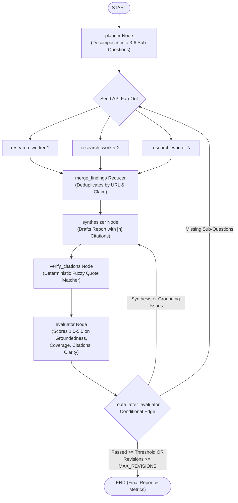

# Autonomous Deep Research Agent

A portfolio-grade, production-structured **Autonomous Deep Research Agent** built with **LangGraph**, **Google Gemini**, **Serper**, **trafilatura**, **FastAPI**, and **Streamlit**.

Given a complex research prompt, the agent autonomously plans sub-questions, executes parallel web researchers, extracts grounded findings, synthesizes a structured report with strict inline citations (`[1]`, `[2]`), runs a **deterministic citation verifier** against cached source text, and evaluates the draft with an LLM evaluator—automatically triggering conditional revision loops if quality criteria are not satisfied.

---

## Key Features

- **LangGraph State Machine Orchestration**: Fan-out execution using LangGraph's dynamic `Send` API with state deduplication reducers.
- **Deterministic Citation Verification**: Verifies source resolution and validates exact evidence quotes against retrieved webpage text using fuzzy sequence matching (`difflib.SequenceMatcher`) *before* evaluation—eliminating LLM self-policing hallucinations.
- **Evaluator & Conditional Revision Loop**: Multi-dimensional grading across *Groundedness*, *Coverage*, *Citation Accuracy*, and *Clarity* with automated routing back to missing research or report synthesis up to a configurable revision ceiling (`MAX_REVISIONS`).
- **Free-Tier Protection & Rate Limiting**: Shared async token bucket rate limiter (`LLM_RPM=8`, `LLM_RPD=200`) with jittered exponential backoff on HTTP 429 status codes.
- **Two-Tier Disk Caching**: Query and extracted HTML content indexed with SHA-256 hashing to guarantee zero-cost repeated queries during development.
- **Dual-Model Optimization**: Routes high-volume researcher extraction to lightweight, fast models (`gemini-2.0-flash-lite`) while reserving high-reasoning models (`gemini-2.0-flash`) for planning, synthesis, and evaluation.
- **Full Observability & Hard Budget Guard**: Local JSONL span tracing (`./runs/<run_id>/trace.jsonl`), tree visualizer, pricing calculation from YAML config, and a hard execution stop when costs exceed `MAX_RUN_COST_USD`.
- **Single Execution Path (`runner.py`)**: Unified asynchronous event emitter consumed identically by the CLI, FastAPI Server-Sent Events (SSE), and Streamlit UI.
- **Strict Architectural Decoupling**: Streamlit UI is a 100% thin client communicating strictly over HTTP/SSE with zero imports from internal graph or tool modules.

---

## System Architecture


---

## LangGraph Execution Flow & Revision Loop



---

## Sample Run Output

### 1. Interactive CLI Execution (`agent run`)

```bash
$ python main.py run "How do solid-state batteries compare to lithium-ion in 2026?"
```

```text
╭──────────────────────── Autonomous Research Agent ────────────────────────╮
│ Question: How do solid-state batteries compare to lithium-ion in 2026?   │
│ Model: gemini-2.0-flash / gemini-2.0-flash-lite                          │
│ Max Revisions: 2 | Budget: $2.00                                         │
╰──────────────────────────────────────────────────────────────────────────╯

[10:14:02] INFO     [run_started] Run ID: run_20261120_101402_Solid_State
[10:14:04] INFO     [plan_created] Generated 4 targeted sub-questions
[10:14:08] INFO     [finding_added] Finding added from: quantumscape.com/technology
[10:14:09] INFO     [finding_added] Finding added from: batterytechonline.com/materials
[10:14:12] INFO     [finding_added] Finding added from: nature.com/articles/energy
[10:14:15] INFO     [synthesis_completed] Report draft synthesized with 8 claims
[10:14:15] INFO     [verification_completed] Verified 8 citations (0 invalid)
[10:14:18] INFO     [evaluation_ready] Score: 4.60/5.00 (PASSED)
[10:14:18] SUCCESS  [run_completed] Research completed successfully!

# Solid-State vs. Lithium-Ion Batteries: Comparative Analysis (2026)

## Executive Summary
Solid-state battery (SSB) architectures have transitioned from experimental pilot cells to low-volume production vehicles in 2026, offering energy densities exceeding 450 Wh/kg compared to top-tier liquid electrolyte lithium-ion cells at ~300 Wh/kg [1]. However, manufacturing cost disparities and interfacial impedance remain limiting factors for mass adoption [2].

## Energy Density and Volumetric Performance
Lithium-ion cells utilizing silicon-dominant anodes achieve approximately 750 Wh/L volumetric energy density [3]. In contrast, solid-state designs featuring metallic lithium anodes surpass 1,000 Wh/L, yielding up to a 35% reduction in pack footprint [1].

## Thermal Stability and Safety Profiles
Liquid electrolytes remain susceptible to thermal runaway at temperatures exceeding 130°C due to flammable organic solvents [2]. Solid ceramic and sulfide electrolyte separators eliminate volatile organic liquids, raising dendrite resistance and increasing thermal breakdown thresholds beyond 200°C [4].

## Sources
[1] QuantumScape Technology Brief 2026 - https://quantumscape.com/technology (Retrieved: 2026-11-20)
[2] Battery Tech Review: Electrolyte Interfaces - https://batterytechonline.com/materials (Retrieved: 2026-11-20)
[3] Contemporary Lithium-Ion Cell Benchmarks - https://nature.com/articles/energy (Retrieved: 2026-11-20)
[4] Solid State Separator Safety Testing - https://sae.org/standards/battery-safety (Retrieved: 2026-11-20)
```

---

### 2. Execution Span Tree (`agent trace <run_id>`)

```bash
$ python main.py trace run_20261120_101402_Solid_State
```

```text
└── planner [node] (1240ms, 412 tok, $0.0000)
    ├── researcher_0 [node] (3410ms, 1250 tok, $0.0001)
    │   ├── serper_search [tool] (420ms, $0.0010)
    │   ├── fetch_page [tool] (850ms)
    │   └── extract_findings [llm] (1820ms, 1020 tok, $0.0001)
    ├── researcher_1 [node] (3180ms, 1180 tok, $0.0001)
    │   ├── serper_search [tool] (390ms, $0.0010)
    │   ├── fetch_page [tool] (910ms)
    │   └── extract_findings [llm] (1680ms, 960 tok, $0.0001)
    ├── researcher_2 [node] (3550ms, 1310 tok, $0.0001)
    │   ├── serper_search [tool] (440ms, $0.0010)
    │   ├── fetch_page [tool] (780ms)
    │   └── extract_findings [llm] (2100ms, 1080 tok, $0.0001)
    ├── synthesizer [node] (2850ms, 2450 tok, $0.0002)
    ├── citation_verifier [node] (15ms)
    └── evaluator [node] (1920ms, 1680 tok, $0.0002)
```

---

### 3. Cost & Consumption Summary Table

| Category / Node | Input Tokens | Output Tokens | Total Cost (USD) |
| :--- | :--- | :--- | :--- |
| **`planner`** | 280 | 132 | \$0.000045 |
| **`research_worker`** (Parallel) | 2,450 | 1,290 | \$0.000305 |
| **`synthesizer`** | 1,820 | 630 | \$0.000215 |
| **`evaluator`** | 1,240 | 440 | \$0.000155 |
| **Model: `gemini-2.0-flash-lite`** | 2,450 | 1,290 | \$0.000305 |
| **Model: `gemini-2.0-flash`** | 3,340 | 1,202 | \$0.000415 |
| **Serper Searches** (3 queries @ \$0.001) | — | — | \$0.003000 |
| **Page Text Extraction** (5 URLs) | — | — | \$0.000000 (Local) |
| **TOTAL RUN METRICS** | **5,790 tokens** | **Latency: 12.6s** | **\$0.003720** |
| **Cost per Cited Claim** | **\$0.000465** (8 claims) | **Budget Exceeded** | **False** |
| **Remaining Free-Tier Quota** | **194 requests / 200 daily** | **Status** | **Completed** |

---

## Design Decisions & Engineering Rationale

1. **Deterministic Citation Verification Before LLM Evaluation**:
   LLMs are notoriously prone to hallucinated self-verification. Rather than asking an LLM whether citations are truthful, `research_agent/verification/citations.py` deterministically parses all numeric references `[n]`, maps them to the source list, and performs fuzzy sequence matching (`difflib.SequenceMatcher(ratio >= 0.70)`) against the actual scraped page text. Unsupported claims or phantom citations are flagged in state *before* the evaluator scores the draft.

2. **Free-Tier Token Bucket Rate Limiter (`rate_limiter.py`)**:
   Free-tier Gemini quotas restrict accounts to 15 RPM and 200 RPD. To prevent parallel worker crashes, all LLM calls route through a singleton `AsyncTokenBucketRateLimiter` configured by default to 8 RPM and 200 RPD. When rate limits or transient errors occur, requests apply exponential backoff with jitter and honor upstream `retry-after` headers.

3. **Two-Tier SHA-256 Disk Caching**:
   `research_agent/tools/cache.py` caches Serper JSON responses and trafilatura extracted markdown in `.cache/serper/` and `.cache/pages/`. Repeated identical queries during development or revision loops cost zero API calls and complete instantly.

4. **Dual-Model Cost Strategy**:
   - `gemini-2.0-flash-lite`: Used for worker query generation and factual findings extraction where speed and cost efficiency matter most.
   - `gemini-2.0-flash`: Used for question decomposition, synthesis, and evaluative grading where reasoning and adherence to structured schemas are critical.

5. **Single Execution Path (`runner.py`)**:
   To avoid duplicate logic across execution modes, CLI commands, FastAPI background tasks, and external scripts all invoke `run_research(question, options)`. State progression is broadcast via an `asyncio.Queue` emitting strongly-typed `Event` models.

6. **Strict Architectural Decoupling**:
   Streamlit runs strictly as a client UI. It communicates with FastAPI over HTTP/SSE and has **zero direct imports** from `research_agent.graph` or `research_agent.tools`. This boundary is verified in CI via AST boundary assertions (`tests/test_ui_boundary.py`).

---

## Testing Strategy & Mocks

All 53 unit and boundary tests run completely offline without requiring active API keys or spending quota:
- **`MOCK_LLM`**: Pre-recorded structured Pydantic responses simulate planner decomposition, worker extraction, draft synthesis, and evaluator scoring.
- **`MOCK_SERPER`**: Mock HTTP transport simulates Serper responses with realistic search result items.
- **`MOCK_FETCH`**: Injected mock HTTP payloads simulate extracted HTML content and edge cases (404s, timeouts, empty bodies).

To run a live end-to-end integration test against live Gemini and Serper APIs:
```bash
LIVE_TEST=true pytest -k test_live_integration
```

---

## Project Structure

```text
autonomus-research-agent/
├── research_agent/
│   ├── config/
│   │   ├── pricing.yaml             # Model token rates & Serper search pricing
│   │   └── settings.py              # Pydantic Settings & environment validation
│   ├── graph/
│   │   ├── nodes/
│   │   │   ├── planner.py           # Sub-question decomposition node
│   │   │   ├── researcher.py        # Parallel worker node (Serper + extraction)
│   │   │   ├── synthesizer.py       # Report draft & citation assembly node
│   │   │   └── evaluator.py         # Multi-criteria scoring & feedback node
│   │   ├── builder.py               # LangGraph compilation & revision routing
│   │   └── state.py                 # Pydantic ResearchState & merge reducers
│   ├── llm/
│   │   ├── client.py                # Gemini model factory & response extraction
│   │   └── rate_limiter.py          # Token bucket RPM/RPD limiter & backoff
│   ├── observability/
│   │   ├── metrics.py               # Cost calculation, budget guard & summary
│   │   └── tracer.py                # Local JSONL tracer & ASCII span tree
│   ├── service/
│   │   ├── api.py                   # FastAPI app with SSE stream & auth
│   │   ├── runner.py                # Single execution path & typed Event queue
│   │   └── schemas.py               # REST API request/response schemas
│   ├── tools/
│   │   ├── cache.py                 # SHA-256 disk cache for search & web pages
│   │   ├── fetch.py                 # Trafilatura HTTP extraction tool
│   │   └── serper.py                # Serper search API client tool
│   ├── ui/
│   │   └── app.py                   # Streamlit thin HTTP client application
│   ├── verification/
│   │   └── citations.py             # Deterministic fuzzy citation verifier
│   └── cli.py                       # Typer CLI (agent run & agent trace)
├── tests/
│   ├── test_api.py                  # FastAPI endpoints & SSE stream tests
│   ├── test_citations.py            # Deterministic citation verifier tests
│   ├── test_config.py               # Settings & pricing YAML loader tests
│   ├── test_evaluator.py            # Evaluator scoring & threshold tests
│   ├── test_graph_phase2.py         # Planner & researcher fan-out tests
│   ├── test_graph_phase3.py         # Synthesizer & source assembly tests
│   ├── test_live_integration.py     # Live Gemini + Serper integration test
│   ├── test_observability.py        # Tracer, metrics & budget guard tests
│   ├── test_planner.py              # Planner Pydantic schema tests
│   ├── test_rate_limiter.py         # Token bucket & backoff timing tests
│   ├── test_researcher.py           # Worker execution & extraction tests
│   ├── test_revision_loop.py        # Conditional loop & MAX_REVISIONS tests
│   ├── test_state.py                # State model & merge reducer tests
│   ├── test_synthesizer.py          # Report synthesis format tests
│   ├── test_tools.py                # Serper, fetch & disk cache tests
│   └── test_ui_boundary.py          # AST boundary test (no backend imports)
├── main.py                          # CLI entrypoint script
├── pyproject.toml                   # Project dependencies & tool configurations
├── .env.example                     # Environment template
└── README.md                        # Project documentation
```

---

## Installation & Setup

### 1. Prerequisites
- **Python 3.11+** (Python 3.13 tested and verified)
- **uv** (recommended) or standard `pip`

### 2. Environment Configuration
Clone the repository and copy the environment template:
```bash
cp .env.example .env
```

Edit `.env` with your API keys:
```env
# Required for live search & LLM generation
GEMINI_API_KEY=your_gemini_api_key_here
SERPER_API_KEY=your_serper_api_key_here

# Model Selection
PLANNER_MODEL=gemini-2.0-flash
RESEARCHER_MODEL=gemini-2.0-flash-lite
WRITER_MODEL=gemini-2.0-flash
EVALUATOR_MODEL=gemini-2.0-flash

# Rate Limiter & Budget
LLM_RPM=8
LLM_RPD=200
MAX_RUN_COST_USD=2.00
MAX_REVISIONS=2
EVAL_PASS_THRESHOLD=3.5

# Optional API Security
# API_KEY=secret_token
```

### 3. Install Dependencies
Using `uv`:
```bash
uv sync
```
Or using standard `pip`:
```bash
python -m venv .venv
source .venv/bin/activate  # On Windows: .venv\Scripts\activate
pip install -e .
```

---

## Running the Application

### 1. Command-Line Interface (CLI)

Run research directly in your terminal:
```bash
python main.py run "What are the recent breakthroughs in mRNA cancer vaccines?"
```

With custom options:
```bash
python main.py run "Explain quantum error correction milestones in 2026" --max-revisions 3 --max-cost 1.50
```

Inspect execution traces and latencies:
```bash
python main.py trace <run_id>
```

### 2. FastAPI REST & SSE Service

Start the backend API server:
```bash
uvicorn research_agent.service.api:app --reload
```
- Interactive OpenAPI Docs: `http://127.0.0.1:8000/docs`
- Healthcheck: `GET http://127.0.0.1:8000/health`
- Live SSE Event Stream: `GET http://127.0.0.1:8000/runs/{run_id}/events`

### 3. Streamlit Web Client

In a separate terminal, launch the Streamlit frontend:
```bash
streamlit run research_agent/ui/app.py
```
- Open `http://localhost:8501`
- Enter your research topic, configure revision limits, and watch live SSE events stream the plan, worker findings, citation verification, evaluation scores, and final markdown report.

### 4. Running Tests & Linters

Run the complete test suite (53 unit & boundary tests):
```bash
pytest
```

Run code formatting & linting checks:
```bash
ruff check .
```

---

## Known Limitations

- **Single-Process Run State**: Run metadata and active queues are maintained in process memory (along with `./runs` on disk). For multi-replica production scaling, state persistence should be migrated to PostgreSQL and event broadcasting to Redis Pub/Sub.
- **Client-Rendered JavaScript**: The page extraction pipeline uses `trafilatura` for fast, lightweight HTML-to-text conversion. Single-page applications requiring heavy client-side JavaScript execution (e.g. React/Vue SPAs without SSR) may yield limited body text compared to a headless browser like Playwright.
- **Serper Free-Tier Limits**: Free Serper API keys provide 2,500 lifetime queries; production deployments with high volume should configure paid tier credits.
